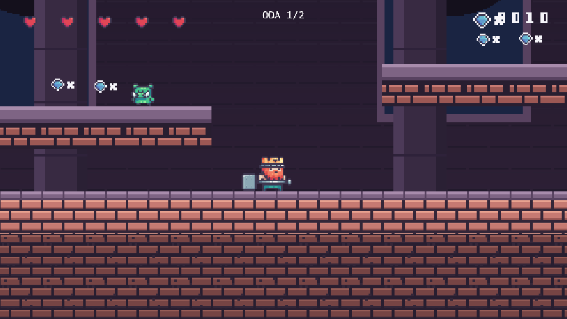
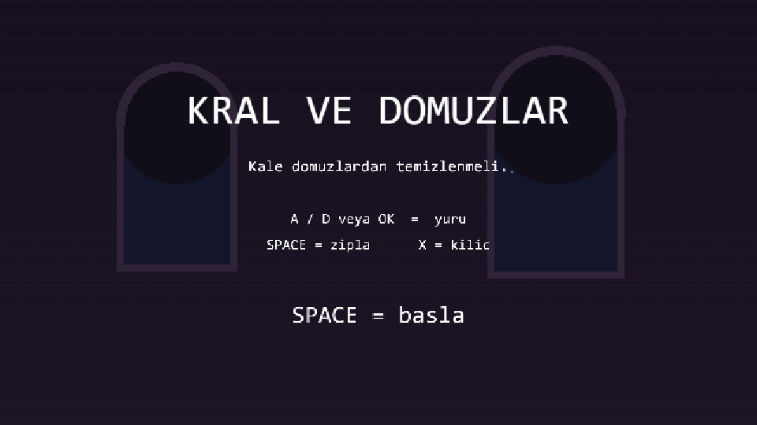
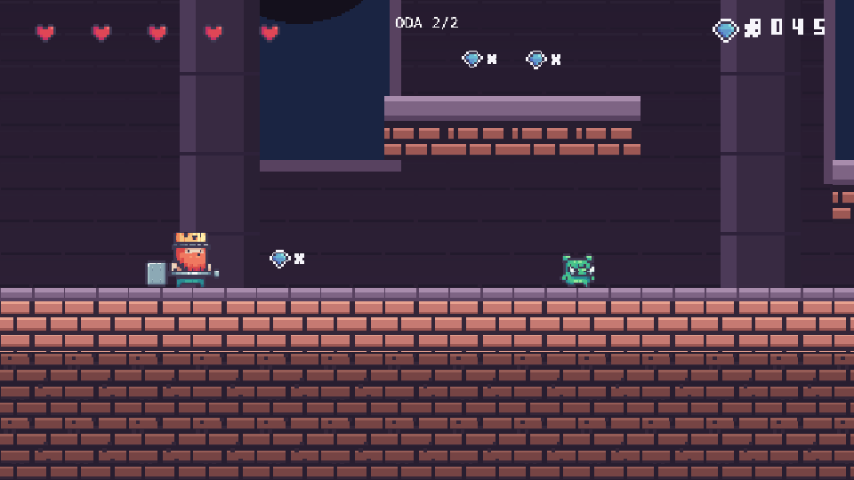

# Kral ve Domuzlar · KAPLAY

60 dakikalık 2D Agent Game Jam için **Kral ve Domuzlar**: kale platformer / brawler.
Motor KAPLAY 3001.x, dahili fizik; harici fizik kütüphanesi yok.

**Canlı demo:** https://abdullahkaplann14-creator.github.io/kral-ve-domuzlar/



<details>
<summary>Menü ve Oda 2 ekran görüntüleri</summary>




</details>

## Çalıştırma

```bash
npm install
npm run dev      # http://localhost:5173
```

Yardımcı komutlar:

```bash
npm run assets     # castle tile + arka plan + sfx üretir (deterministik)
npm run measure    # public/assets PNG boyutlarını / kare sayılarını listeler
npm run import:kp  # Kings and Pigs ZIP'ini public/assets'e aktarır
node scripts/smoke.mjs http://localhost:5199/   # headless Chrome testi + ekran görüntüsü
node scripts/analyze.mjs tiles public/assets/tiles/terrain.png   # tileset ızgarası
node scripts/analyze.mjs bbox public/assets/king/idle.png 78     # sprite sınırları
```

## Kontroller

| Tuş | İşlev |
| --- | --- |
| `A` / `D` veya `←` / `→` | Yürü |
| `SPACE` / `↑` / `W` | Zıpla (basılı tut = daha yüksek) |
| `X` / `J` | Kılıç saldırısı |
| `SPACE` (menü / game over) | Başla / tekrar dene |

## Mekanikler

1. Yerçekimi + zemin/platform çarpışması
2. Yürüme + hız
3. Değişken yükseklikte zıplama
4. Coyote time (zeminden ayrıldıktan sonra kısa süre zıplayabilme)
5. Jump buffer (inişten hemen önce basılan zıplama kuyruğa alınır)
6. Kılıç saldırısı (menzil içindeki domuzları öldürür)
7. Stomp (domuzun üstüne atlayınca ezme + zıplama)
8. Domuz devriye AI (platform sınırları içinde gidip gelme)
9. Altın toplama + skor
10. Kalp toplama + can
11. 3 can/hasar + dokunulmazlık (blink)
12. Diken hasarı
13. Oda geçişi (kapı) + iki ayrı oda
14. Kamera takibi (yumuşak, clamp'li)

## İçerik puan listesi

Sunumda bu liste sırayla gösterilir; her satır oyunda tetiklenmeli.

### Mekanik (+3 / adet)
- [ ] Yürüme + yerçekimi
- [ ] Değişken yükseklikte zıplama
- [ ] Coyote time
- [ ] Jump buffer
- [ ] Kılıç saldırısı
- [ ] Stomp
- [ ] Domuz devriye AI
- [ ] Altın toplama + skor
- [ ] Kalp toplama
- [ ] Hasar + dokunulmazlık
- [ ] Oda geçişi (kapı)

### Animasyonlu karakter / düşman tipi (+2 / adet)
- [ ] Kral (oyuncu) — idle / run / jump / fall / attack
- [ ] Domuz — idle / run / dead
- [ ] Kral Domuz — idle / run / dead

### Animasyon durumu (+1 / adet)
- [ ] `idle` (11 kare)
- [ ] `run` (8 kare)
- [ ] `jump` / `fall`
- [ ] `attack` (3 kare)
- [ ] düşman `dead` (4 kare)
- [ ] altın `spin` (8 kare), kalp `beat` (8 kare)

### Level / oda / sahne (+2 / adet)
- [ ] Oda 1 — kale avlusu (60×12 tile)
- [ ] Oda 2 — dikenli çukur + kral domuz
- [ ] Menü
- [ ] Game over
- [ ] Zafer ekranı

### Parallax katmanı (+1 / adet, 3. katmandan itibaren)
- [ ] Kale duvarı + pencereler (0.50×)
- [ ] Sütunlar (0.75×)

### Juice (+1 / adet)
- [ ] Altın toplama parçacıkları
- [ ] Düşman ölüm parçacıkları
- [ ] İniş tozu
- [ ] Ekran sarsıntısı (hasar / stomp)
- [ ] Hasar sonrası blink
- [ ] Altın/kalp bob animasyonu

### UI (+1 / adet)
- [ ] Can göstergesi (kalp sprite'ları)
- [ ] Skor (bitmap rakamlar)
- [ ] Oda sayacı
- [ ] Başlangıç ekranı
- [ ] Zafer ekranı

### Ses (+1 / 2 efekt, müzik +2)
- [ ] `jump`, `coin`, `hit`, `slash`, `stomp`, `death` (6 efekt = +3)

### Twist (+3)
- [ ] 30. dakikada çekilecek kart (henüz eklenmedi)

## Dosya yapısı

```text
index.html
src/main.js              # tüm oyun (tek dosya)
scripts/gen-assets.mjs   # castle tile + bg + sfx üreteci
scripts/import-kp.mjs    # Kings and Pigs paketini aktarır
scripts/assets.mjs       # PNG ölçüm
scripts/pnglib.mjs       # PNG oku/yaz/kırp (bağımlılıksız)
scripts/analyze.mjs      # tileset ızgarası / sprite bbox / crop
scripts/smoke.mjs        # headless Chrome smoke testi
public/assets/
  king/{idle,run,jump,fall,hit,dead,attack,ground}.png   (78x58)
  pig/{idle,run,jump,fall,hit,dead,attack,ground}.png    (34x28)
  king_pig/{...}.png                                     (38x28)
  bomb_pig/{idle,run,picking_bomb,throwing_boom}.png     (26x26)
  frog/{idle,run,jump,fall,hit,double_jump}.png          (32x32, Pixel Adventure 1)
  fruits/{apple,banana,cherries,kiwi,melon,orange,pineapple,strawberry}.png
  ui/{coin,diamond,heart,live_bar,numbers}.png
  tiles/{terrain,decor}.png
  props/{door,door_open,box,bomb,boom,cannon}.png
  bg/{castle,pillars,blue,green,yellow,brown,gray,pink,purple}.png
  terrain.png, traps/                                    (Pixel Adventure 1)
  {ground,dirt,platform,spike}.png
  sfx/{jump,coin,hit,slash,stomp,death}.wav
```

## Lisans / Atıf

- Kod: MIT (`LICENSE`).
- Kings and Pigs — Pixel Frog (CC0). Tüm karakter, tile ve UI sprite'ları bu paketten.
- Pixel Adventure 1 — Pixel Frog (ücretsiz paket). `frog/`, `fruits/`, `bg/` renk desenleri,
  `terrain.png` ve `traps/` bu paketten; kaynak ZIP `Downloads/Pixel Adventure 1.zip`
  içinden `npm run import:pa1` ile aktarılır.
- `bg/`, `ground.png`, `dirt.png`, `platform.png`, `spike.png` ve `sfx/` bu depoda
  kodla üretildi (CC0), paket paletine uyacak şekilde.
- Ses üretimi isteğe bağlı olarak `jsfxr` ile değiştirilebilir.
